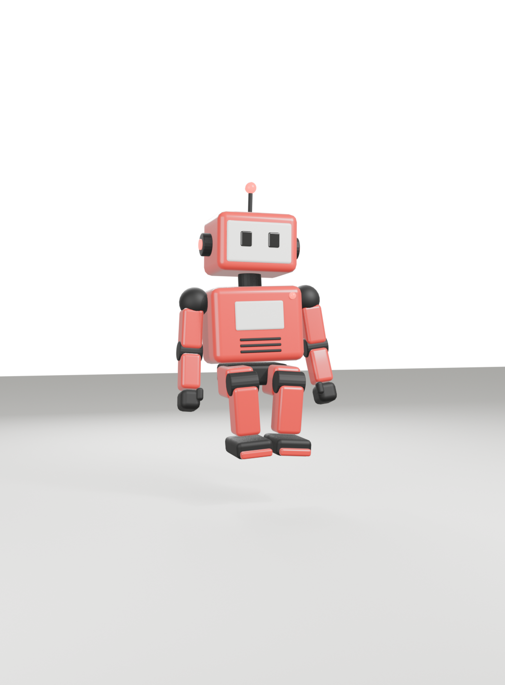

# Red Robot

A brutalist 3D mascot built entirely from code: one Blender Python script models it, rigs it, animates it, bakes its shading and exports a web-ready `.glb`. It's the character that walks through [my portfolio](https://github.com/sahan8/portfolio).



## What's inside

| | |
|---|---|
| **Model** | 10.5k triangles, boxy parts with bevelled edges, one skinned mesh |
| **Rig** | 20 bones (rigid skinning: every part follows one bone) |
| **Animations** | Idle, Walk, Run, Jump, Wave, Dance, ThumbsUp, Yes, Sit |
| **Shading** | Clear-coated red paint, ink rubber, cream screen, red lights; baked ambient occlusion (1024 px WebP) |
| **Web file** | `export/red-robot.web.glb`, about 690 KB, quantized, no decoder needed |

Colours come from the portfolio's palette: red `#e61919`, ink `#111`, cream `#f4f4f0`.

## Build

Needs Blender 5.2 (the commands use the Flatpak build) and Node.js.

```bash
npm install
npm run build      # runs scripts/build_robot.py in Blender, then compresses the export
npm run inspect    # size, triangles, animations of the web file
```

`build` writes:

- `red-robot.blend`: the full scene, to open and tweak by hand
- `export/red-robot.glb`: straight from Blender
- `export/red-robot.web.glb`: compressed for the web (keyframes resampled, unused data pruned, vertices quantized)

Skip the ambient-occlusion bake for a quick test run:

```bash
flatpak run org.blender.Blender -b --factory-startup --python "$PWD/scripts/build_robot.py" -- --no-bake
```

## Renders

`scripts/render.py` renders stills and the showreel from `red-robot.blend` with EEVEE:

```bash
B="flatpak run org.blender.Blender -b $PWD/red-robot.blend --python $PWD/scripts/render.py --"
$B still  $PWD/renders/still.png
$B sheet  $PWD/renders/sheet          # 4 phases of every animation
$B showreel $PWD/renders/reel         # frames; encode with ffmpeg
```

## Using it in three.js

```jsx
const { scene, animations } = useGLTF('/models/red-robot.web.glb', false, false);
const { actions } = useAnimations(animations, group);
actions.Idle.play();
```

Every clip keys every bone, so switching clips never leaves a limb in the previous pose. Looping clips (Idle, Walk, Run, Dance) end on their first frame.
